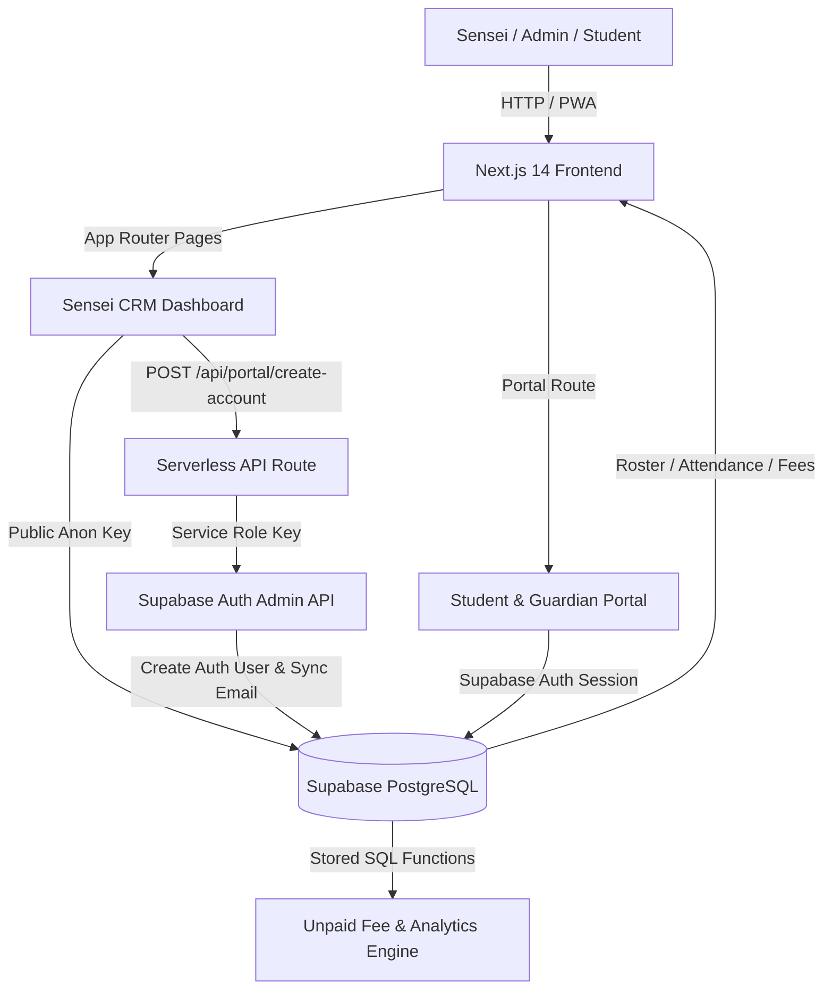

# 🥋 Institute of Karate and Allied Arts — Kolnad Dojo CRM

> A modern, full-stack Web & Mobile CRM application built for **Kolnad Dojo** to manage student enrollment, belt rank progressions, attendance roll calls, and monthly fee ledgers, featuring a dedicated **Student & Guardian Self-Service Portal**.

---

## 🌟 Executive Overview & Key Resume Highlights

If you are including this project in your **resume or technical portfolio**, here is a summary of the core architectural engineering concepts implemented in this application:

- **Next.js 14 App Router & React 18**: Built using Next.js 14 with client-side reactive components (`'use client'`), dynamic routes (`app/student/[id]/page.tsx`), and serverless API route handlers (`app/api/portal/create-account/route.ts`).
- **Supabase PostgreSQL Backend & Security Model**: Integrated with Supabase PostgreSQL, leveraging **Row Level Security (RLS)**, compound unique key constraints (`student_id` + `month_year`), atomic `upsert` operations, and stored SQL database functions (`get_unpaid_students`).
- **Dual Authentication Architecture**: Public client (`supabaseClient.ts`) for browser RLS operations alongside a secure serverless admin client (`supabaseAdmin.ts`) utilizing `SUPABASE_SERVICE_ROLE_KEY` with disabled session persistence for administrative user creation.
- **Interactive Data Visualization**: Integrated **Recharts** for historical monthly attendance analytics, featuring dynamic month breakdown views, interactive bar triggers, and custom tooltips displaying exact present/absent dates.
- **Timezone-Safe Date Computation**: Implemented custom date math algorithms to prevent UTC-offset shifting bugs (e.g. IST +5:30 boundaries causing date drift into preceding months).
- **Multi-Tenant / Family Email Disambiguation**: Handled complex edge cases where multiple siblings share a single parent email address through dynamic profile selection modals.
- **Progressive Web App (PWA) Capabilities**: Service worker readiness and native web installation prompts (`InstallPrompt.tsx`) for mobile roll-call usage directly in the dojo.
- **Curated Traditional Dojo Design System**: Customized dark aesthetic inspired by traditional martial arts (black belt accents `#D4A843`, seal red `#8B261D`, moss green `#4C7A5E`, parchment `#EDE6D6`).

---

## 📐 System Architecture & Data Flow



---

## 🛠️ Technology Stack

| Layer | Technology | Key Usage |
| :--- | :--- | :--- |
| **Framework** | Next.js 14 (App Router) | Server-side rendering, API routes, Client components |
| **Language** | TypeScript 5.5 | End-to-end type safety (`Student`, `Attendance`, `Fee`, `BELTS`) |
| **Backend / Database** | Supabase (PostgreSQL) | Auth, Row Level Security (RLS), Stored SQL functions, Real-time JS SDK |
| **Styling** | Tailwind CSS & PostCSS | Custom color tokens, dark theme, responsive grid layouts |
| **Data Visualization** | Recharts 2.12 | Interactive bar charts, monthly attendance participation analytics |
| **Animations** | Framer Motion 11.3 | Smooth UI transitions & alert keyframes |
| **PWA** | Web App Manifest & Service Worker | Mobile installation prompts & offline capabilities |

---

## 💡 Key Architectural & Technical Concepts

### 1. Dual-Client Supabase Authentication Architecture
- **Browser Client (`lib/supabaseClient.ts`)**: Uses `NEXT_PUBLIC_SUPABASE_ANON_KEY` to interact with public/RLS-scoped tables for attendance roll calls and fee ledger updates.
- **Server Administrative Client (`lib/supabaseAdmin.ts`)**: Instantiated on the server using `SUPABASE_SERVICE_ROLE_KEY`. Configured with `{ auth: { persistSession: false, autoRefreshToken: false } }` to safely invoke privileged Auth APIs (`auth.admin.createUser`) without polluting runtime sessions.

### 2. Relational Database Schema & Concurrency Handling
- **`students`**: Contains primary profile info, belt ranks, monthly fee baseline, and linked email address.
- **`attendance`**: Maps `student_id` to `class_date` and attendance status (`present: boolean`).
- **`fees`**: Stores monthly fee tracking (`student_id`, `month_year`, `paid`, `paid_date`, `amount`).
- **Atomic `upsert` Operations**: Prevents race conditions and duplicate fee entries when toggling monthly payment statuses by using `upsert` with an `onConflict: 'student_id,month_year'` strategy.

### 3. Multi-Profile Email Linking (Family Support)
In martial arts dojos, siblings often share a single parent email address. The portal dynamically inspects user emails against student records:
- If a single match is found, it automatically opens the dashboard.
- If multiple matches are found (e.g. two children enrolled under one parent email), a **Profile Switcher** modal allows seamless switching between student profiles without requiring re-authentication.

### 4. Timezone-Safe Date Calculations
Standard JavaScript `toISOString()` converts dates to UTC, which can cause date boundary shifts in local timezones like IST (+5:30) (e.g., July 1 at 12:00 AM IST becomes June 30 UTC). Custom helpers (`firstOfMonth`, `lastNMonths`) compute dates using local date components to guarantee consistent calendar filtering across all geographic regions.

### 5. Custom Sorting Algorithms for Martial Arts Ranks
Standard database sorting formats belt ranks alphabetically (e.g., Black Belt before Blue Belt). The system enforces a domain-specific rank order array (`BELTS` constant: `White` $\rightarrow$ `Yellow` $\rightarrow$ `Orange` $\rightarrow$ `Green` $\rightarrow$ `Blue` $\rightarrow$ `Purple` $\rightarrow$ `Brown` $\rightarrow$ `Black`), sorting student rosters hierarchically.

### 6. WhatsApp Fee Reminders
- A new student gets a pending fee record beginning in their enrollment month; older months are not shown as due in the fee ledger, student profile, or portal.
- WhatsApp reminders are sent to active students with unpaid fees and a phone number on the first day of each month. Vercel cron runs at 00:00 UTC; manual dispatch is available in the Fee Ledger.
- Configure `WHATSAPP_ACCESS_TOKEN`, `WHATSAPP_PHONE_NUMBER_ID`, `WHATSAPP_TEMPLATE_NAME`, `WHATSAPP_TEMPLATE_LANGUAGE`, and `WHATSAPP_GRAPH_API_VERSION` as server-side environment variables. The approved Meta template must have three body placeholders in this order: student name, month, and amount.
- Set `CRON_SECRET` in the deployment environment. Vercel sends it to the scheduled endpoint; the manual WhatsApp dialog also requires this key. Never expose it through a `NEXT_PUBLIC_` variable.
- Enter student phone numbers in international format with a country code (for example, `+91...`). WhatsApp templates and opt-in must comply with Meta’s current messaging rules.

---

## 📁 Repository Structure

```
dojo-crm/
├── app/
│   ├── api/portal/create-account/  # Serverless API route for portal provisioning
│   ├── kata-kumite/                # Martial arts competition rules reference
│   ├── portal/                     # Student & guardian self-service portal
│   ├── student/[id]/               # Individual student profile & detailed analytics
│   ├── techniques/                 # Dojo technique reference library
│   ├── globals.css                 # Custom design tokens & theme utility classes
│   ├── layout.tsx                  # Root layout wrapper & meta config
│   └── page.tsx                    # Main Sensei Dashboard (Attendance & Fee Ledger)
├── components/
│   ├── AddStudentForm.tsx          # Modal/Form for registering new students
│   ├── AttendanceSection.tsx       # Daily roll call, roster view & overview grid
│   ├── BeltTag.tsx                 # Dynamic rank badge with custom belt colors
│   ├── FeesSection.tsx             # Interactive 6-month dojo fee matrix
│   ├── InstallPrompt.tsx           # PWA installation prompt for mobile devices
│   ├── PortalAccountSetup.tsx      # Admin tool for generating student credentials
│   └── PortalProfileCard.tsx       # Self-service profile management for portal users
├── lib/
│   ├── pwa.ts                      # Service worker & PWA installation utilities
│   ├── supabaseAdmin.ts            # Privileged service-role Supabase client
│   ├── supabaseClient.ts           # Public Supabase JS client wrapper
│   └── types.ts                    # TypeScript interfaces & date utilities
└── scripts/
    └── create-portal-accounts.mjs  # Automation script for batch portal account setup
```

---

## 🎯 Resume Bullet Points (Copy & Paste Ready)

Here are tailored resume bullet points you can use based on this project:

- **Full-Stack Developer | Kolnad Dojo CRM & Student Portal**
  - Engineered a full-stack CRM and student portal using **Next.js 14 (App Router)**, **TypeScript**, and **Supabase (PostgreSQL)** to automate attendance tracking, belt rank progressions, and fee ledgers.
  - Built secure serverless API routes using **Supabase Admin Service Role API** for automated account creation and configured **Row Level Security (RLS)** policies for database data protection.
  - Implemented interactive data visualizations with **Recharts**, delivering monthly attendance participation charts with custom interactive tooltips.
  - Optimized database operations using **atomic PostgreSQL upsert queries** to eliminate race conditions during concurrent fee ledger updates.
  - Architected a multi-profile authentication flow supporting family email sharing across multiple enrolled students, complete with timezone-safe date math for IST/UTC compatibility.
  - **Automated Gmail Fee Reminders**: Configured scheduled end-of-month fee reminder emails via Gmail SMTP (`Nodemailer` + Vercel Cron), alongside an instant manual trigger in the Sensei Fee Ledger dashboard.

---

## 📧 Gmail Fee Reminders Setup

To send automated fee reminders from your personal/dojo Gmail address:

1. **Enable 2-Step Verification** on your Google Account: [Google Security Settings](https://myaccount.google.com/security).
2. **Generate a Gmail App Password**: Go to [App Passwords](https://myaccount.google.com/apppasswords), create an password named `Kolnad Dojo CRM`.
3. Add the credentials to `.env.local` (or Vercel Environment Variables):
   ```env
   GMAIL_USER="your-email@gmail.com"
   GMAIL_APP_PASSWORD="xxxx xxxx xxxx xxxx"
   CRON_SECRET="your-secure-cron-secret-token"
   ```
4. **Schedule**: The system automatically dispatches emails to active unpaid students at **23:59 on the last day of every month**. You can also click **"✉️ Send Gmail Reminders"** in the Fee Ledger dashboard at any time.

---

## 💬 WhatsApp Fee Reminders Setup

1. Configure a Meta WhatsApp Cloud API sender and create an approved message template with **three body placeholders**, in this order: student name, month, and amount.
2. Add the following server-side environment variables to `.env.local` or the Vercel project. Use a supported Graph API version for your Meta app:
   ```env
   WHATSAPP_ACCESS_TOKEN="your-meta-whatsapp-access-token"
   WHATSAPP_PHONE_NUMBER_ID="your-whatsapp-phone-number-id"
   WHATSAPP_TEMPLATE_NAME="approved_fee_reminder_template"
   WHATSAPP_TEMPLATE_LANGUAGE="en"
   WHATSAPP_GRAPH_API_VERSION="v23.0"
   CRON_SECRET="your-secure-cron-secret-token"
   ```
3. Set each student's phone number in international format, including its country code. Obtain the required WhatsApp opt-in before sending reminders.
4. The Vercel cron sends WhatsApp reminders at **00:00 UTC on the 1st of each month** to active students who have a pending fee for that month and a phone number. Use **"💬 Send WhatsApp Reminders"** in the Fee Ledger for a manual send; it requires the `CRON_SECRET` value.

New students start their fee ledger in the month they enroll. Earlier months are excluded from the fee ledger, student profile, portal, and reminder totals.

---

## 🚀 Local Development Setup

1. **Navigate to app directory**:
   ```bash
   cd dojo-crm
   ```

2. **Install dependencies**:
   ```bash
   npm install
   ```

3. **Start local development server**:
   ```bash
   npm run dev
   ```

4. Open `http://localhost:3000` in your browser.

---

## 📦 Deployment

Deploy easily to Vercel:
```bash
npm i -g vercel
cd dojo-crm
vercel deploy --prod
```

---

## 📄 License
Created for Institute of Karate and Allied Arts (Kolnad Dojo). All rights reserved.
